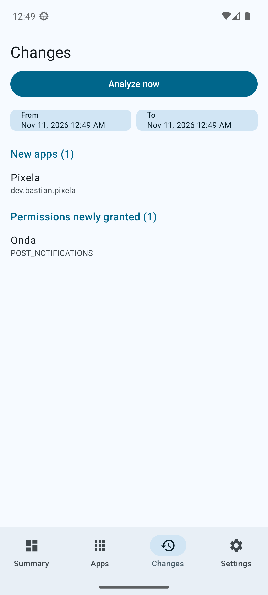
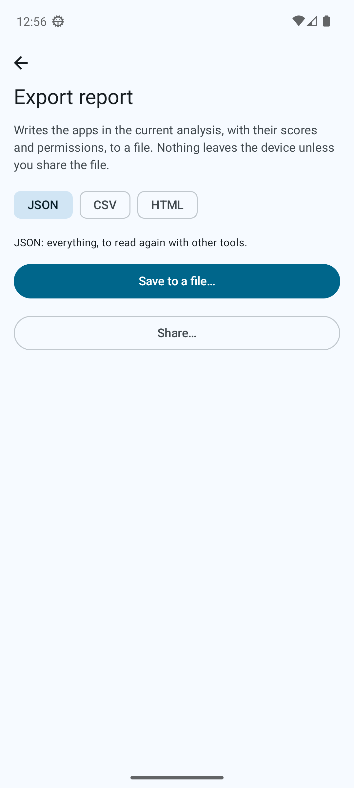
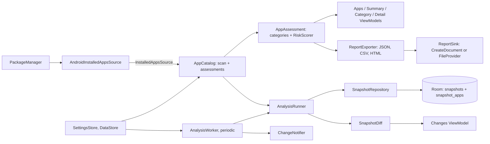
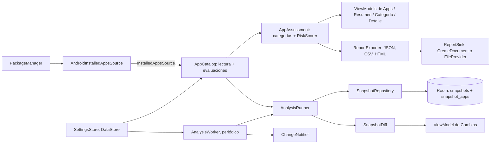

# Lupa

[English](#english) · [Español](#español)

## English

A privacy auditor for the apps installed on an Android device. It reads every installed app with `PackageManager`, groups the permissions each one asks for and has been granted, gives it an explainable risk score, keeps snapshots so it can show what changed (new apps, new permissions, permissions granted or revoked) and exports reports as JSON, CSV or HTML.

Everything happens on the device. The app has **no `INTERNET` permission**.

The point of the project is platform knowledge (`PackageManager`, the permission model, install sources, package visibility), data processing off the main thread with progress, and measured performance.

100% Kotlin and Jetpack Compose (Material 3).

> **Status:** built, unit-tested (95 tests, including Robolectric tests for Room, WorkManager, notifications and the file sink), linted (no errors) and exercised on an Android API 33 phone emulator. A Baseline Profile is generated and committed. See [Known limitations](#known-limitations) for what was not checked.

### Screenshots

| | | |
|---|---|---|
|  |  |  |
| Summary: risk levels, old target API, access by category | Apps filtered by high risk (9, same as the summary card) | Detail with the score breakdown |
|  |  |  |
| Which apps have Contacts access | Changes between two analyses | Notification from the periodic analysis |
|  |  |  |
| Export screen | The HTML report (rendered with Edge on a PC) | System share sheet |

The emulator has 212 packages (7 installed by hand, 205 system), which is why many system apps rank as high risk: the Google app, Play services and the shell really do hold most of the sensitive permissions.

### Features

- **Reading:** every installed app with package, name, version, system flag, `targetSdk`, `minSdk`, first install and last update, installer, requested permissions with grant state and protection level, and exported components (activities, services, receivers, providers). An app that fails to be read is skipped and counted; the scan goes on.
- **Summary:** number of apps, distribution by risk level, apps with an old target API, and a card per permission category ("25 apps with Contacts access"). Every card opens the list or the category screen showing exactly the apps that were counted.
- **Apps:** icon, name, score and category chips; search by name or package; filters (user or system, risk level, category, old target API); sort by risk, name or last update. A lazy list with stable keys; scrolled by hand with 212 rows (no frame figures, see Performance).
- **Detail:** general data, the score breakdown (every item with its points), permissions grouped by category with state and a short explanation, exported components, and a button that opens the app's system settings.
- **Changes:** history of the last 20 snapshots; compare any two. Shows new, removed and updated apps, new permissions, newly granted and revoked permissions.
- **Periodic analysis:** a daily (12 h, 1 d, 2 d or 7 d) background analysis that notifies, and opens the Changes screen, when a permission was granted or a high-risk app appeared. The notification permission is asked only when the user turns the option on.
- **Export:** JSON, CSV or a self-contained HTML page, saved with the system document picker (`CreateDocument`) or shared through a `FileProvider`.
- Light and dark theme, dynamic color on Android 12+, edge-to-edge, English and Spanish.

### Build and run

Requirements: JDK 17 and the Android SDK (`compileSdk` 36). Create `local.properties` with your `sdk.dir`.

```bash
./gradlew assembleDebug testDebugUnitTest lintDebug
```

On Windows use `.\gradlew.bat`. Install `app/build/outputs/apk/debug/app-debug.apk` on a device or emulator (`minSdk` 26).

Benchmarks and Baseline Profile (device or emulator connected; see [Performance](#performance)):

```bash
./gradlew :app:generateBaselineProfile                       # writes app/src/release/generated/baselineProfiles
./gradlew :baselineprofile:connectedBenchmarkReleaseAndroidTest
```

### QUERY_ALL_PACKAGES and Google Play

Since Android 11 an app only sees the packages it declares in `<queries>` or that are visible by default. An app whose whole job is to list every installed app cannot work with a fixed list, so Lupa declares the `QUERY_ALL_PACKAGES` permission.

Google Play restricts that permission to a short list of core use cases (device search, antivirus, file managers and a few more) and requires a declaration for review. Lupa is a portfolio piece distributed outside Play, so it simply declares the permission; publishing it on Play would require a justification or a different design. The manifest says so next to the permission.

### Architecture

Layers per package: `domain` (pure Kotlin: models, permission catalog, scoring, diff, report formats, ports), `data` (PackageManager source, Room snapshots, DataStore settings, Coil icon fetcher, WorkManager worker, notifier, file sink), `ui` (Compose screens and ViewModels), `di` (Koin modules). Room entities never leave `data`.



The data source sits behind `InstalledAppsSource` so tests use a fake one. Clock and dispatchers are injected; the score, the diff and the exporters are pure functions.

### How the score works

The score goes from 0 to 100 and is the sum of the items below, capped at 100. The weights live in one place, `RiskWeights` in `domain/RiskScore.kt`, and the detail screen always lists the items behind a score. **It is an indicator of how much an app can see and do, not a verdict on whether it is trustworthy or misusing anything.**

| Item | Points |
|---|---|
| Background location granted | 20 |
| Accessibility service declared | 20 |
| SMS granted | 15 |
| Draw over other apps granted | 12 |
| Device administrator declared | 10 |
| Location, microphone, install apps, all files access | 8 each |
| Camera, contacts, phone and call log | 6 each |
| Usage access | 5 |
| Body sensors | 4 |
| Calendar, storage and media | 3 each |
| Physical activity, nearby devices | 2 each |
| Notifications | 1 |
| Category asked for in the manifest but **not** granted | a quarter of its weight (at least 1) |
| Target API below 23 / 23-28 / 29-30 / 31+ | 15 / 8 / 4 / 0 |
| Origin not verified (no installer recorded, or an APK opened with the package installer) | 10 |
| Microphone + background location both active | 10 |
| Overlay + accessibility both active | 15 |
| SMS + contacts both active | 6 |

Levels: low below 20, medium 20-49, high 50 and above. Several permissions of one category count once (fine and coarse location are one "Location"). System apps are not given the origin penalty, since "pre-installed" is their origin.

Special accesses (overlay, install packages, all files, usage access) are read through `AppOpsManager`, because the granted flags are not reliable for them. Accessibility and device admin come from the components the app declares, not from whether the user enabled them.

### Decisions

- **Koin 4.2.2 instead of Hilt**, a choice applied across all the apps in this portfolio. WorkManager workers are built through `koin-androidx-workmanager` (`workManagerFactory()` plus `workerOf`); `hilt-work` is not used. Noted in `VERSIONES.md`.
- **One scan per app after listing the names.** `getInstalledPackages(0)` gives the names, then each app is read with its own `getPackageInfo` call. It is slower than one big call but a single broken app costs only itself, and it gives real progress. Protection levels are cached by permission name.
- **Everything is stored and filtered afterwards.** Snapshots hold all apps; the "include system apps" setting is applied when reading (list, summary, diff, export). Changing the setting never invalidates history.
- **Snapshots as one row per app** (`snapshot_apps`, JSON payload) instead of one big blob: a snapshot with a few hundred apps would pass the 2 MB cursor window limit of SQLite on Android.
- **"Scan again" and "Analyze now" are different.** The refresh buttons in Summary and Apps re-read the device in memory; only "Analyze now" (Changes) and the periodic worker store a snapshot. Otherwise opening the app a few times would push real history out of the 20 kept.
- **A new permission already granted counts as "new permission", not as "newly granted".** "Newly granted" means it was asked for and denied before. The notification fires for both, plus new high-risk apps.
- **Report formats.** JSON is the full data and is read back by the tests; CSV is RFC 4180 and neutralises cells that start with `= + - @` (a leading apostrophe) so a spreadsheet cannot run them; HTML has no scripts and no external resources and escapes every dynamic string.
- **Per-category explanations, not per-permission.** Each category has a short explanation; the exact permission names and protection levels are listed under it.
- **Notification permission only on demand.** Turning on the periodic analysis asks for `POST_NOTIFICATIONS` (API 33+). If it is denied, the analysis still runs and the Changes screen still shows everything; the settings screen says that no notification will appear.
- **R8 is off** in the release build, as in the other apps of the portfolio, so the Baseline Profile lists plain class and method names.
- Discarded: Ktor/OkHttp (no network by design), `material3-adaptive` (a bottom bar is enough here), tracker detection by SDK signatures and revoking permissions (out of scope; Android does not allow the latter).

### Performance

Taken on an Android 13 (API 33, x86_64) phone emulator with `androidx.benchmark.suppressErrors=EMULATOR`, which tells Macrobenchmark to run despite the emulator. **These numbers are only a rough guide**: emulators do not behave like phones for startup, JIT or frame timing. They should be repeated on a physical device.

Scanning 212 apps (all system apps included) takes about **1.6 s** (median of 8 cold starts, `lupa.scan` trace section), on a background thread with progress, so the UI is never blocked.

| Benchmark (8 iterations) | Without profile | With Baseline Profile |
|---|---|---|
| Cold start, time to initial display (median) | 584 ms | 595 ms |
| Cold start, time to initial display (min / max) | 526 / 691 ms | 535 / 763 ms |
| Scan time (median) | 1660 ms | 1614 ms |
| Frames while scrolling the list | 165 | 165 |

What this shows: on the emulator the profile makes **no measurable difference**. The start is dominated by the first scan, which is `PackageManager` work, not code that the profile can precompile, and the emulator's frame metrics did not report durations (only frame counts), so no scroll jank figure could be taken. The profile is generated, committed (25,665 rules, about 1,300 of them from `dev.bastian.lupa`) and installed with `profileinstaller`; judging its value needs a physical device.

The Baseline Profile was generated on the emulator with root (`adb root`; API 28-33 need it). The journey in `BaselineProfileGenerator` covers startup, the summary, the list and scrolling, the detail screen and the other tabs. Running `adb root` while a Gradle instrumentation run is in progress kills the run, so do it before.

### Known limitations

- Not run on a physical phone: the scoring on a device with hundreds of varied apps, the real notification cadence of the daily worker and the benchmark figures on real hardware are untested. The forced job run (`cmd jobscheduler run -f`) is ignored by WorkManager when it is before the scheduled time; the worker itself was seen running right after the option was enabled.
- The HTML report was not opened in the emulator's browser (Chrome asks for a first-run consent there). It was rendered with Edge on a PC and checked with an HTML parser.
- `AppOps` modes for overlay, install packages, all files and usage access were not seen with a real app holding them on the emulator; the code falls back to the granted flag if the call is refused.
- Robolectric cannot resolve `FileProvider` roots on Windows, so the sink test replaces that one step. The real provider was exercised by sharing from the emulator.
- Installer detection uses a short list of known stores and package installers; unknown stores count as "other installer" and are not penalised.
- The score is a heuristic. Granted does not mean used, and a low score does not mean safe.
- No instrumented UI tests (`connectedAndroidTest`) for the app itself; the Compose screens are covered by ViewModel tests and emulator walkthroughs.

---

## Español

Un auditor de privacidad para las apps instaladas en un dispositivo Android. Lee todas las apps instaladas con `PackageManager`, agrupa los permisos que pide cada una y los que tiene concedidos, le asigna una puntuación de riesgo explicable, guarda instantáneas para mostrar qué ha cambiado (apps nuevas, permisos nuevos, permisos concedidos o revocados) y exporta informes en JSON, CSV o HTML.

Todo ocurre en el dispositivo. La app **no tiene el permiso `INTERNET`**.

El objetivo del proyecto es mostrar conocimiento de la plataforma (`PackageManager`, el modelo de permisos, el origen de instalación, la visibilidad de paquetes), procesar datos fuera del hilo principal con progreso y medir el rendimiento.

100 % Kotlin y Jetpack Compose (Material 3).

> **Estado:** construida, con tests unitarios (95, incluidos tests con Robolectric de Room, WorkManager, notificaciones y el guardado de archivos), lint sin errores y probada en un emulador de teléfono Android API 33. El Baseline Profile está generado e incluido en el repositorio. En [Limitaciones conocidas](#limitaciones-conocidas) se indica lo que no se ha comprobado.

### Capturas

| | | |
|---|---|---|
|  |  |  |
| Resumen: niveles de riesgo, API de destino antigua, acceso por categoría | Apps filtradas por riesgo alto (9, las mismas que en la tarjeta del resumen) | Detalle con el desglose de la puntuación |
|  |  |  |
| Qué apps tienen acceso a Contactos | Cambios entre dos análisis | Notificación del análisis periódico |
|  |  |  |
| Pantalla de exportación | El informe HTML (renderizado con Edge en un PC) | Hoja de compartir del sistema |

El emulador tiene 212 paquetes (7 instalados a mano y 205 del sistema), por eso muchas apps del sistema salen con riesgo alto: la app de Google, Play Services y la shell tienen de verdad la mayoría de los permisos sensibles.

### Funciones

- **Lectura:** todas las apps instaladas con paquete, nombre, versión, si es de sistema, `targetSdk`, `minSdk`, primera instalación y última actualización, instalador, permisos pedidos con su estado y nivel de protección, y componentes exportados (actividades, servicios, receptores y proveedores). Si una app no se puede leer, se salta y se cuenta; el análisis sigue.
- **Resumen:** número de apps, reparto por nivel de riesgo, apps con una API de destino antigua y una tarjeta por categoría de permiso («25 apps con acceso a Contactos»). Cada tarjeta abre la lista o la pantalla de categoría con exactamente las apps que se contaron.
- **Apps:** icono, nombre, puntuación y etiquetas de categoría; búsqueda por nombre o paquete; filtros (usuario o sistema, nivel de riesgo, categoría, API de destino antigua); orden por riesgo, nombre o última actualización. Lista diferida con claves estables; recorrida a mano con 212 filas (sin cifras de fotogramas, ver Rendimiento).
- **Detalle:** datos generales, desglose de la puntuación (cada concepto con sus puntos), permisos agrupados por categoría con su estado y una explicación breve, componentes exportados y un botón que abre los ajustes del sistema de la app.
- **Cambios:** historial de las últimas 20 instantáneas; se pueden comparar dos cualesquiera. Muestra apps nuevas, eliminadas y actualizadas, permisos nuevos, y permisos recién concedidos y revocados.
- **Análisis periódico:** un análisis en segundo plano diario (cada 12 h, 1 d, 2 d o 7 d) que avisa con una notificación, y abre la pantalla de Cambios, cuando se ha concedido un permiso o ha aparecido una app de riesgo alto. El permiso de notificaciones solo se pide cuando el usuario activa la opción.
- **Exportación:** JSON, CSV o una página HTML autocontenida, guardada con el selector de documentos del sistema (`CreateDocument`) o compartida mediante un `FileProvider`.
- Tema claro y oscuro, color dinámico en Android 12+, edge-to-edge, inglés y español.

### Compilar y ejecutar

Requisitos: JDK 17 y el SDK de Android (`compileSdk` 36). Crea `local.properties` con tu `sdk.dir`.

```bash
./gradlew assembleDebug testDebugUnitTest lintDebug
```

En Windows usa `.\gradlew.bat`. Instala `app/build/outputs/apk/debug/app-debug.apk` en un dispositivo o emulador (`minSdk` 26).

Benchmarks y Baseline Profile (con un dispositivo o emulador conectado; ver [Rendimiento](#rendimiento)):

```bash
./gradlew :app:generateBaselineProfile                       # escribe en app/src/release/generated/baselineProfiles
./gradlew :baselineprofile:connectedBenchmarkReleaseAndroidTest
```

### QUERY_ALL_PACKAGES y Google Play

Desde Android 11 una app solo ve los paquetes que declara en `<queries>` o los que son visibles por defecto. Una app cuyo único trabajo es listar todas las apps instaladas no puede funcionar con una lista fija, así que Lupa declara el permiso `QUERY_ALL_PACKAGES`.

Google Play limita ese permiso a una lista corta de usos principales (búsqueda en el dispositivo, antivirus, gestores de archivos y alguno más) y exige una declaración para revisarlo. Lupa es una pieza de portfolio que se distribuye fuera de Play, así que simplemente declara el permiso; publicarla en Play exigiría una justificación o un diseño distinto. El manifiesto lo indica junto al permiso.

### Arquitectura

Capas por paquete: `domain` (Kotlin puro: modelos, catálogo de permisos, puntuación, diferencias, formatos de informe, puertos), `data` (fuente de PackageManager, instantáneas en Room, ajustes en DataStore, fetcher de iconos para Coil, worker de WorkManager, notificador, guardado de archivos), `ui` (pantallas Compose y ViewModels), `di` (módulos de Koin). Las entidades de Room nunca salen de `data`.



La fuente de datos está detrás de `InstalledAppsSource`, así que los tests usan una falsa. El reloj y los dispatchers se inyectan; la puntuación, las diferencias y los exportadores son funciones puras.

### Cómo funciona la puntuación

La puntuación va de 0 a 100 y es la suma de los conceptos de abajo, con un tope de 100. Los pesos están en un solo sitio, `RiskWeights` en `domain/RiskScore.kt`, y la pantalla de detalle siempre muestra los conceptos que hay detrás de cada puntuación. **Es un indicador de cuánto puede ver y hacer una app, no un veredicto sobre si es de fiar o si hace mal uso de algo.**

| Concepto | Puntos |
|---|---|
| Ubicación en segundo plano concedida | 20 |
| Servicio de accesibilidad declarado | 20 |
| SMS concedido | 15 |
| Mostrar sobre otras apps concedido | 12 |
| Administrador del dispositivo declarado | 10 |
| Ubicación, micrófono, instalar apps, acceso a todos los archivos | 8 cada uno |
| Cámara, contactos, teléfono y registro de llamadas | 6 cada uno |
| Acceso al uso de apps | 5 |
| Sensores corporales | 4 |
| Calendario, almacenamiento y multimedia | 3 cada uno |
| Actividad física, dispositivos cercanos | 2 cada uno |
| Notificaciones | 1 |
| Categoría pedida en el manifiesto pero **no** concedida | una cuarta parte de su peso (mínimo 1) |
| API de destino por debajo de 23 / 23-28 / 29-30 / 31+ | 15 / 8 / 4 / 0 |
| Origen no verificado (sin instalador registrado, o un APK abierto con el instalador de paquetes) | 10 |
| Micrófono + ubicación en segundo plano, ambos activos | 10 |
| Superposición + accesibilidad, ambos activos | 15 |
| SMS + contactos, ambos activos | 6 |

Niveles: bajo por debajo de 20, medio de 20 a 49, alto de 50 en adelante. Varios permisos de una misma categoría cuentan una sola vez (ubicación precisa y aproximada son una sola «Ubicación»). A las apps del sistema no se les aplica la penalización por origen, ya que «preinstalada» es su origen.

Los accesos especiales (superposición, instalar paquetes, todos los archivos, acceso al uso) se leen con `AppOpsManager`, porque para ellos los indicadores de concesión no son fiables. La accesibilidad y el administrador del dispositivo salen de los componentes que declara la app, no de si el usuario los ha activado.

### Decisiones

- **Koin 4.2.2 en lugar de Hilt**, una elección aplicada en todas las apps de este portfolio. Los workers de WorkManager se construyen con `koin-androidx-workmanager` (`workManagerFactory()` más `workerOf`); no se usa `hilt-work`. Anotado en `VERSIONES.md`.
- **Una lectura por app después de listar los nombres.** `getInstalledPackages(0)` da los nombres y luego cada app se lee con su propia llamada a `getPackageInfo`. Es más lento que una única llamada grande, pero una app rota solo se afecta a sí misma y permite mostrar un progreso real. Los niveles de protección se cachean por nombre de permiso.
- **Se guarda todo y se filtra después.** Las instantáneas contienen todas las apps; el ajuste «incluir apps del sistema» se aplica al leer (lista, resumen, diferencias, exportación). Cambiar el ajuste nunca invalida el historial.
- **Instantáneas como una fila por app** (`snapshot_apps`, con el contenido en JSON) en lugar de un único blob grande: una instantánea con unos cientos de apps superaría el límite de 2 MB de la ventana del cursor de SQLite en Android.
- **«Volver a leer» y «Analizar ahora» son cosas distintas.** Los botones de refresco de Resumen y Apps vuelven a leer el dispositivo en memoria; solo «Analizar ahora» (en Cambios) y el worker periódico guardan una instantánea. Si no, abrir la app unas cuantas veces echaría el historial real fuera de las 20 que se conservan.
- **Un permiso nuevo que ya llega concedido cuenta como «permiso nuevo», no como «recién concedido».** «Recién concedido» significa que antes se pedía y estaba denegado. La notificación salta en los dos casos, y también con apps nuevas de riesgo alto.
- **Formatos de informe.** El JSON tiene todos los datos y los tests lo vuelven a leer; el CSV sigue RFC 4180 y neutraliza las celdas que empiezan por `= + - @` (con un apóstrofo delante) para que una hoja de cálculo no pueda ejecutarlas; el HTML no tiene scripts ni recursos externos y escapa todas las cadenas dinámicas.
- **Explicaciones por categoría, no por permiso.** Cada categoría tiene una explicación breve; debajo se listan los nombres exactos de los permisos y sus niveles de protección.
- **Permiso de notificaciones solo cuando hace falta.** Activar el análisis periódico pide `POST_NOTIFICATIONS` (API 33+). Si se deniega, el análisis se sigue ejecutando y la pantalla de Cambios lo sigue mostrando todo; la pantalla de ajustes avisa de que no aparecerá ninguna notificación.
- **R8 está desactivado** en la build de release, como en las demás apps del portfolio, para que el Baseline Profile liste los nombres de clases y métodos sin ofuscar.
- Descartado: Ktor/OkHttp (sin red por diseño), `material3-adaptive` (aquí basta con una barra inferior), detección de rastreadores por firmas de SDK y revocar permisos (fuera de alcance; Android no permite lo segundo).

### Rendimiento

Medido en un emulador de teléfono con Android 13 (API 33, x86_64) con `androidx.benchmark.suppressErrors=EMULATOR`, que indica a Macrobenchmark que se ejecute aunque sea un emulador. **Estas cifras son solo orientativas**: los emuladores no se comportan como un móvil en el arranque, el JIT o los tiempos de fotograma. Habría que repetirlas en un dispositivo físico.

Leer 212 apps (incluidas todas las del sistema) tarda unos **1,6 s** (mediana de 8 arranques en frío, sección de traza `lupa.scan`), en un hilo de fondo con progreso, así que la interfaz nunca se bloquea.

| Benchmark (8 iteraciones) | Sin perfil | Con Baseline Profile |
|---|---|---|
| Arranque en frío, tiempo hasta la primera visualización (mediana) | 584 ms | 595 ms |
| Arranque en frío, tiempo hasta la primera visualización (mín. / máx.) | 526 / 691 ms | 535 / 763 ms |
| Tiempo de lectura (mediana) | 1660 ms | 1614 ms |
| Fotogramas al desplazar la lista | 165 | 165 |

Qué muestra esto: en el emulador el perfil **no supone ninguna diferencia medible**. El arranque lo domina la primera lectura, que es trabajo de `PackageManager` y no código que el perfil pueda precompilar, y las métricas de fotogramas del emulador no dieron duraciones (solo el número de fotogramas), así que no se pudo obtener ninguna cifra de tirones al desplazar. El perfil está generado, incluido en el repositorio (25.665 reglas, unas 1.300 de ellas de `dev.bastian.lupa`) y se instala con `profileinstaller`; valorar su efecto requiere un dispositivo físico.

El Baseline Profile se generó en el emulador con root (`adb root`; en API 28-33 hace falta). El recorrido de `BaselineProfileGenerator` cubre el arranque, el resumen, la lista y su desplazamiento, la pantalla de detalle y las demás pestañas. Ejecutar `adb root` mientras hay una ejecución instrumentada de Gradle en curso la mata, así que hay que hacerlo antes.

### Limitaciones conocidas

- No se ha ejecutado en un móvil físico: no se ha probado la puntuación en un dispositivo con cientos de apps variadas, la cadencia real de las notificaciones del worker diario ni las cifras de los benchmarks en hardware real. WorkManager ignora la ejecución forzada del job (`cmd jobscheduler run -f`) cuando es antes de la hora programada; el worker sí se vio ejecutarse justo después de activar la opción.
- El informe HTML no se abrió en el navegador del emulador (allí Chrome pide aceptar condiciones en el primer arranque). Se renderizó con Edge en un PC y se comprobó con un parser de HTML.
- Los modos de `AppOps` para superposición, instalar paquetes, todos los archivos y acceso al uso no se han visto con una app real que los tenga concedidos en el emulador; si la llamada se rechaza, el código recurre al indicador de concesión.
- En Windows Robolectric no resuelve las raíces del `FileProvider`, así que el test del guardado sustituye ese paso. El proveedor real se probó compartiendo desde el emulador.
- La detección del instalador usa una lista corta de tiendas e instaladores de paquetes conocidos; las tiendas desconocidas cuentan como «otro instalador» y no se penalizan.
- La puntuación es una heurística. Concedido no significa usado, y una puntuación baja no significa seguro.
- No hay tests de UI instrumentados (`connectedAndroidTest`) de la propia app; las pantallas de Compose están cubiertas por tests de ViewModel y por recorridos en el emulador.
