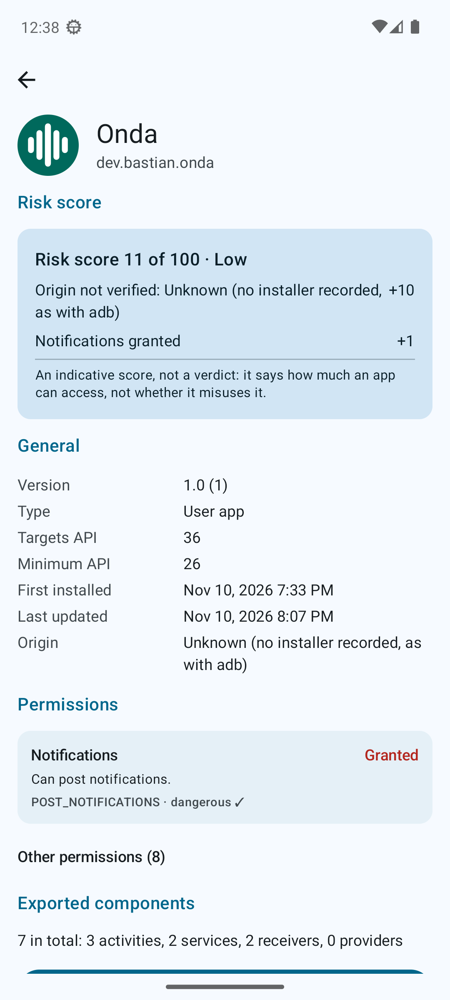

# 🔍 Lupa

**Descubre qué pueden hacer las apps de tu móvil** 
*Find out what the apps on your phone can do*

  

[Español](#español) · [English](#english)

 &nbsp;  &nbsp;  &nbsp; 

## Español

Lupa revisa todas las apps instaladas en tu móvil y te cuenta, en claro, a qué tiene acceso cada una: tu ubicación, el micrófono, la cámara, tus contactos, tus mensajes… Les da una puntuación de riesgo fácil de entender y te avisa cuando algo cambia.

Y todo se queda en tu móvil: **Lupa no se conecta a internet.**

### ✨ Qué puedes hacer

- 📊 **Ver el resumen de tu móvil**: cuántas apps tienen riesgo alto, medio o bajo, y cuántas pueden ver tus contactos, tu ubicación o tu micrófono.
- 🚦 **Conocer el riesgo de cada app** con una puntuación de 0 a 100 que explica de dónde sale cada punto.
- 🔎 **Encontrar lo que buscas** con búsqueda, filtros por riesgo o por tipo de permiso, y orden por riesgo, nombre o fecha.
- 🧾 **Entrar en el detalle** de cualquier app: qué permisos pide, cuáles tiene concedidos y qué significan.
- ⚙️ **Ir directo a sus ajustes** para quitarle un permiso si no te convence.
- 🕒 **Ver qué ha cambiado**: apps nuevas o eliminadas y permisos concedidos o retirados desde el último análisis.
- 🔔 **Recibir un aviso** cuando una app consiga un permiso nuevo o aparezca una app de riesgo alto.
- 📤 **Exportar un informe** en HTML, CSV o JSON para guardarlo o compartirlo.
- 🌗 **Tema claro y oscuro**, en español y en inglés.

---

## English

Lupa checks every app installed on your phone and tells you, in plain words, what each one can access: your location, microphone, camera, contacts, messages… It gives each app an easy-to-read risk score and lets you know when something changes.

And everything stays on your phone: **Lupa never connects to the internet.**

### ✨ What you can do

- 📊 **Get an overview of your phone**: how many apps are high, medium or low risk, and how many can see your contacts, location or microphone.
- 🚦 **Know each app's risk** with a 0 to 100 score that shows where every point comes from.
- 🔎 **Find what you are looking for** with search, filters by risk or permission type, and sorting by risk, name or date.
- 🧾 **Dive into any app**: which permissions it asks for, which ones it has and what they mean.
- ⚙️ **Jump straight to its settings** to take a permission away if you are not happy with it.
- 🕒 **See what changed**: new or removed apps and permissions granted or revoked since the last scan.
- 🔔 **Get notified** when an app gains a new permission or a high-risk app shows up.
- 📤 **Export a report** as HTML, CSV or JSON to keep or share.
- 🌗 **Light and dark theme**, in English and Spanish.

---

Parte de mi portfolio de apps Android · Part of my Android app portfolio 
<a href="https://github.com/basd1/bitacora">Bitácora</a> · <a href="https://github.com/basd1/intervalo">Intervalo</a> · <a href="https://github.com/basd1/onda">Onda</a> · <a href="https://github.com/basd1/pixela">Pixela</a> · <a href="https://github.com/basd1/lupa">Lupa</a>

