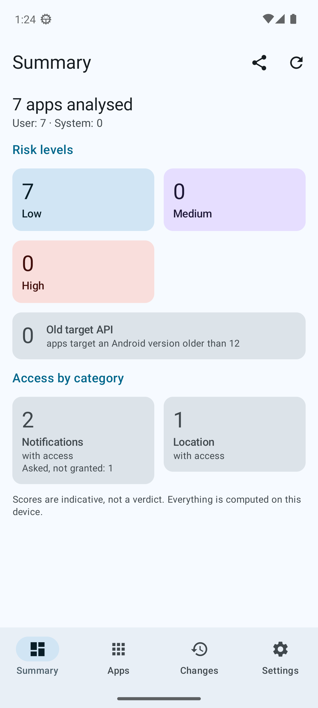
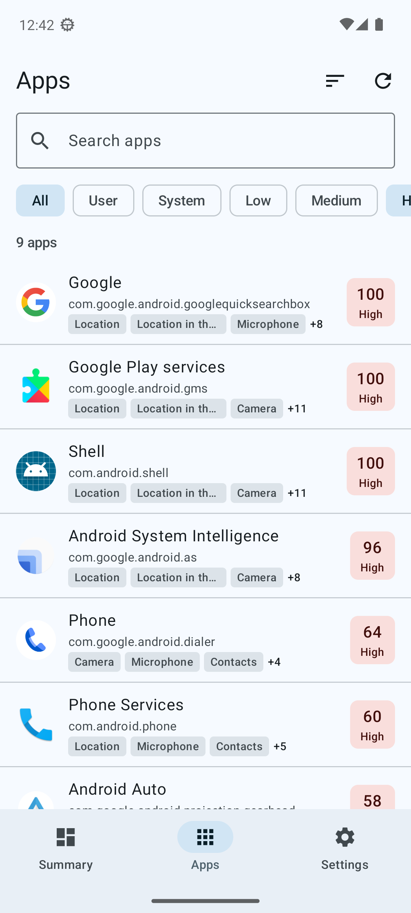
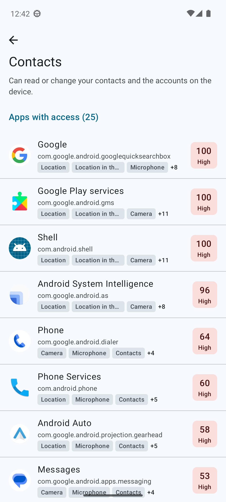
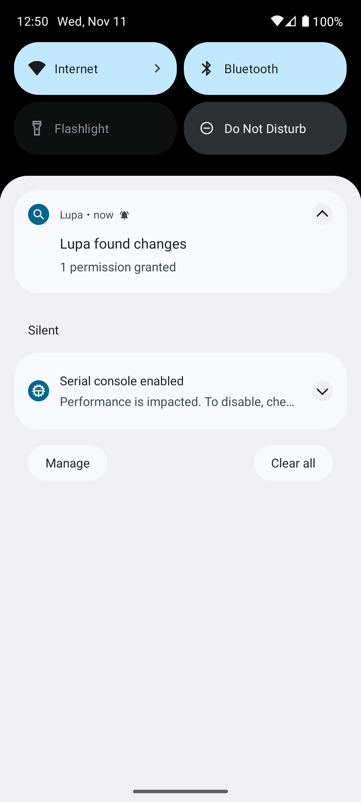
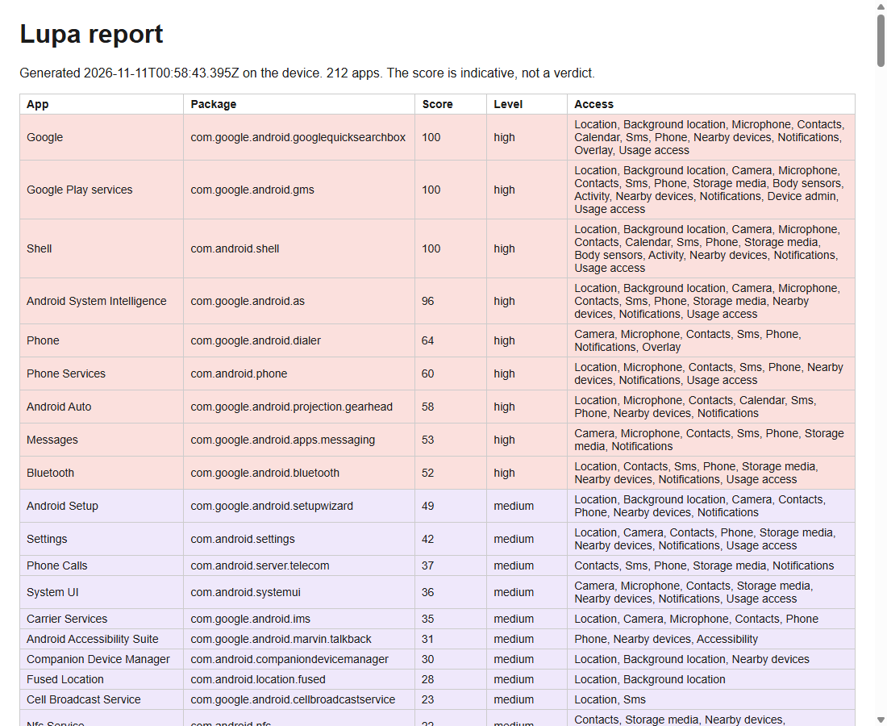
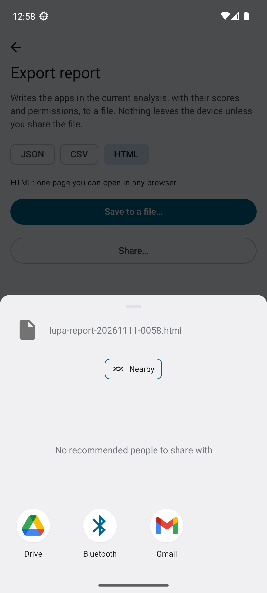
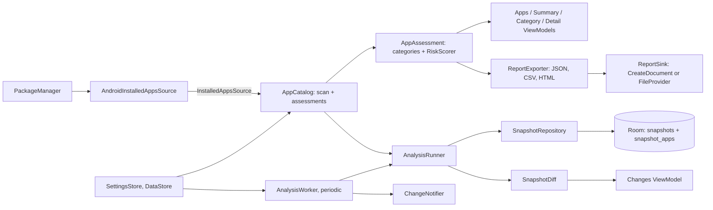

# Lupa

A privacy auditor for the apps installed on an Android device. It reads every installed app with `PackageManager`, groups the permissions each one asks for and has been granted, gives it an explainable risk score, keeps snapshots so it can show what changed (new apps, new permissions, permissions granted or revoked) and exports reports as JSON, CSV or HTML.

Everything happens on the device. The app has **no `INTERNET` permission**.

The point of the project is platform knowledge (`PackageManager`, the permission model, install sources, package visibility), data processing off the main thread with progress, and measured performance.

100% Kotlin and Jetpack Compose (Material 3).

> **Status:** built, unit-tested (95 tests, including Robolectric tests for Room, WorkManager, notifications and the file sink), linted (no errors) and exercised on an Android API 33 phone emulator (`portfolio_phone`). A Baseline Profile is generated and committed. See [Known limitations](#known-limitations) for what was not checked.

## Screenshots

| | | |
|---|---|---|
|  |  |  |
| Summary: risk levels, old target API, access by category | Apps filtered by high risk (9, same as the summary card) | Detail with the score breakdown |
|  |  |  |
| Which apps have Contacts access | Changes between two analyses | Notification from the periodic analysis |
|  |  |  |
| Export screen | The HTML report (rendered with Edge on a PC) | System share sheet |

The emulator has 212 packages (7 installed by hand, 205 system), which is why many system apps rank as high risk: the Google app, Play services and the shell really do hold most of the sensitive permissions.

## Features

- **Reading:** every installed app with package, name, version, system flag, `targetSdk`, `minSdk`, first install and last update, installer, requested permissions with grant state and protection level, and exported components (activities, services, receivers, providers). An app that fails to be read is skipped and counted; the scan goes on.
- **Summary:** number of apps, distribution by risk level, apps with an old target API, and a card per permission category ("25 apps with Contacts access"). Every card opens the list or the category screen showing exactly the apps that were counted.
- **Apps:** icon, name, score and category chips; search by name or package; filters (user or system, risk level, category, old target API); sort by risk, name or last update. A lazy list with stable keys; scrolled by hand with 212 rows (no frame figures, see Performance).
- **Detail:** general data, the score breakdown (every item with its points), permissions grouped by category with state and a short explanation, exported components, and a button that opens the app's system settings.
- **Changes:** history of the last 20 snapshots; compare any two. Shows new, removed and updated apps, new permissions, newly granted and revoked permissions.
- **Periodic analysis:** a daily (12 h, 1 d, 2 d or 7 d) background analysis that notifies, and opens the Changes screen, when a permission was granted or a high-risk app appeared. The notification permission is asked only when the user turns the option on.
- **Export:** JSON, CSV or a self-contained HTML page, saved with the system document picker (`CreateDocument`) or shared through a `FileProvider`.
- Light and dark theme, dynamic color on Android 12+, edge-to-edge, English and Spanish.

## Build and run

Requirements: JDK 17 and the Android SDK (`compileSdk` 36). Create `local.properties` with your `sdk.dir`.

```bash
./gradlew assembleDebug testDebugUnitTest lintDebug
```

On Windows use `.\gradlew.bat`. Install `app/build/outputs/apk/debug/app-debug.apk` on a device or emulator (`minSdk` 26).

Benchmarks and Baseline Profile (device or emulator connected; see [Performance](#performance)):

```bash
./gradlew :app:generateBaselineProfile                       # writes app/src/release/generated/baselineProfiles
./gradlew :baselineprofile:connectedBenchmarkReleaseAndroidTest
```

## QUERY_ALL_PACKAGES and Google Play

Since Android 11 an app only sees the packages it declares in `<queries>` or that are visible by default. An app whose whole job is to list every installed app cannot work with a fixed list, so Lupa declares the `QUERY_ALL_PACKAGES` permission.

Google Play restricts that permission to a short list of core use cases (device search, antivirus, file managers and a few more) and requires a declaration for review. Lupa is a portfolio piece distributed outside Play, so it simply declares the permission; publishing it on Play would require a justification or a different design. The manifest says so next to the permission.

## Architecture

Layers per package: `domain` (pure Kotlin: models, permission catalog, scoring, diff, report formats, ports), `data` (PackageManager source, Room snapshots, DataStore settings, Coil icon fetcher, WorkManager worker, notifier, file sink), `ui` (Compose screens and ViewModels), `di` (Koin modules). Room entities never leave `data`.



The data source sits behind `InstalledAppsSource` so tests use a fake one. Clock and dispatchers are injected; the score, the diff and the exporters are pure functions.

## How the score works

The score goes from 0 to 100 and is the sum of the items below, capped at 100. The weights live in one place, `RiskWeights` in `domain/RiskScore.kt`, and the detail screen always lists the items behind a score. **It is an indicator of how much an app can see and do, not a verdict on whether it is trustworthy or misusing anything.**

| Item | Points |
|---|---|
| Background location granted | 20 |
| Accessibility service declared | 20 |
| SMS granted | 15 |
| Draw over other apps granted | 12 |
| Device administrator declared | 10 |
| Location, microphone, install apps, all files access | 8 each |
| Camera, contacts, phone and call log | 6 each |
| Usage access | 5 |
| Body sensors | 4 |
| Calendar, storage and media | 3 each |
| Physical activity, nearby devices | 2 each |
| Notifications | 1 |
| Category asked for in the manifest but **not** granted | a quarter of its weight (at least 1) |
| Target API below 23 / 23-28 / 29-30 / 31+ | 15 / 8 / 4 / 0 |
| Origin not verified (no installer recorded, or an APK opened with the package installer) | 10 |
| Microphone + background location both active | 10 |
| Overlay + accessibility both active | 15 |
| SMS + contacts both active | 6 |

Levels: low below 20, medium 20-49, high 50 and above. Several permissions of one category count once (fine and coarse location are one "Location"). System apps are not given the origin penalty, since "pre-installed" is their origin.

Special accesses (overlay, install packages, all files, usage access) are read through `AppOpsManager`, because the granted flags are not reliable for them. Accessibility and device admin come from the components the app declares, not from whether the user enabled them.

## Decisions

- **Koin 4.2.2 instead of Hilt**, chosen by the project owner and applied across the portfolio. WorkManager workers are built through `koin-androidx-workmanager` (`workManagerFactory()` plus `workerOf`); `hilt-work` is not used. Noted in `VERSIONES.md`.
- **One scan per app after listing the names.** `getInstalledPackages(0)` gives the names, then each app is read with its own `getPackageInfo` call. It is slower than one big call but a single broken app costs only itself, and it gives real progress. Protection levels are cached by permission name.
- **Everything is stored and filtered afterwards.** Snapshots hold all apps; the "include system apps" setting is applied when reading (list, summary, diff, export). Changing the setting never invalidates history.
- **Snapshots as one row per app** (`snapshot_apps`, JSON payload) instead of one big blob: a snapshot with a few hundred apps would pass the 2 MB cursor window limit of SQLite on Android.
- **"Scan again" and "Analyze now" are different.** The refresh buttons in Summary and Apps re-read the device in memory; only "Analyze now" (Changes) and the periodic worker store a snapshot. Otherwise opening the app a few times would push real history out of the 20 kept.
- **A new permission already granted counts as "new permission", not as "newly granted".** "Newly granted" means it was asked for and denied before. The notification fires for both, plus new high-risk apps.
- **Report formats.** JSON is the full data and is read back by the tests; CSV is RFC 4180 and neutralises cells that start with `= + - @` (a leading apostrophe) so a spreadsheet cannot run them; HTML has no scripts and no external resources and escapes every dynamic string.
- **Per-category explanations, not per-permission.** Each category has a short explanation; the exact permission names and protection levels are listed under it.
- **Notification permission only on demand.** Turning on the periodic analysis asks for `POST_NOTIFICATIONS` (API 33+). If it is denied, the analysis still runs and the Changes screen still shows everything; the settings screen says that no notification will appear.
- **R8 is off** in the release build, as in the other apps of the portfolio, so the Baseline Profile lists plain class and method names.
- Discarded: Ktor/OkHttp (no network by design), `material3-adaptive` (a bottom bar is enough here), tracker detection by SDK signatures and revoking permissions (out of scope; Android does not allow the latter).

## Performance

Taken on the `portfolio_phone` emulator (Android 13, x86_64) with `androidx.benchmark.suppressErrors=EMULATOR`, which tells Macrobenchmark to run despite the emulator. **These numbers are only a rough guide**: emulators do not behave like phones for startup, JIT or frame timing. They should be repeated on a physical device.

Scanning 212 apps (all system apps included) takes about **1.6 s** (median of 8 cold starts, `lupa.scan` trace section), on a background thread with progress, so the UI is never blocked.

| Benchmark (8 iterations) | Without profile | With Baseline Profile |
|---|---|---|
| Cold start, time to initial display (median) | 584 ms | 595 ms |
| Cold start, time to initial display (min / max) | 526 / 691 ms | 535 / 763 ms |
| Scan time (median) | 1660 ms | 1614 ms |
| Frames while scrolling the list | 165 | 165 |

What this shows: on the emulator the profile makes **no measurable difference**. The start is dominated by the first scan, which is `PackageManager` work, not code that the profile can precompile, and the emulator's frame metrics did not report durations (only frame counts), so no scroll jank figure could be taken. The profile is generated, committed (25,665 rules, about 1,300 of them from `dev.bastian.lupa`) and installed with `profileinstaller`; judging its value needs a physical device.

The Baseline Profile was generated on the emulator with root (`adb root`; API 28-33 need it). The journey in `BaselineProfileGenerator` covers startup, the summary, the list and scrolling, the detail screen and the other tabs. Running `adb root` while a Gradle instrumentation run is in progress kills the run, so do it before.

## Known limitations

- Not run on a physical phone: the scoring on a device with hundreds of varied apps, the real notification cadence of the daily worker and the benchmark figures on real hardware are untested. The forced job run (`cmd jobscheduler run -f`) is ignored by WorkManager when it is before the scheduled time; the worker itself was seen running right after the option was enabled.
- The HTML report was not opened in the emulator's browser (Chrome asks for a first-run consent there). It was rendered with Edge on a PC and checked with an HTML parser.
- `AppOps` modes for overlay, install packages, all files and usage access were not seen with a real app holding them on the emulator; the code falls back to the granted flag if the call is refused.
- Robolectric cannot resolve `FileProvider` roots on Windows, so the sink test replaces that one step. The real provider was exercised by sharing from the emulator.
- Installer detection uses a short list of known stores and package installers; unknown stores count as "other installer" and are not penalised.
- The score is a heuristic. Granted does not mean used, and a low score does not mean safe.
- No instrumented UI tests (`connectedAndroidTest`) for the app itself; the Compose screens are covered by ViewModel tests and emulator walkthroughs.
